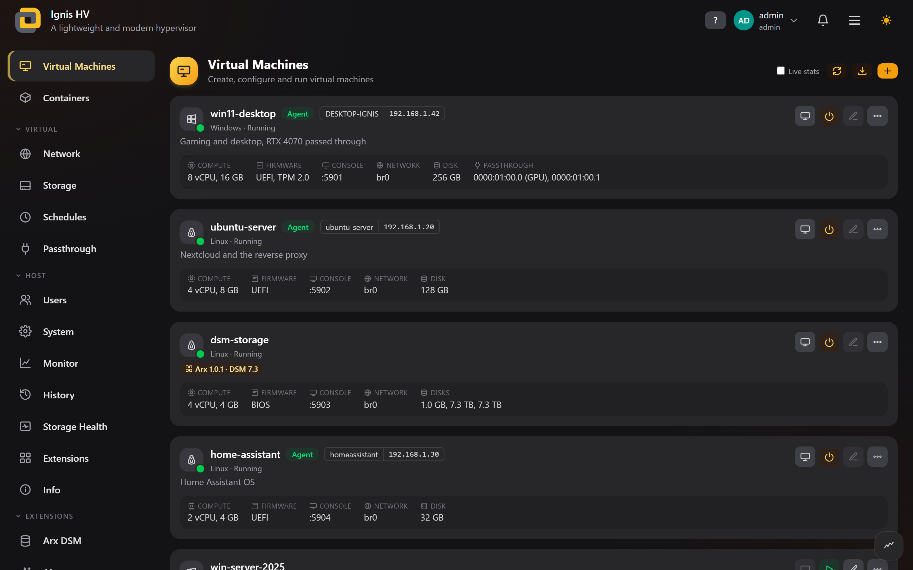
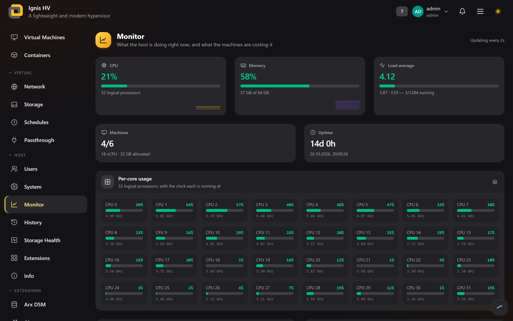
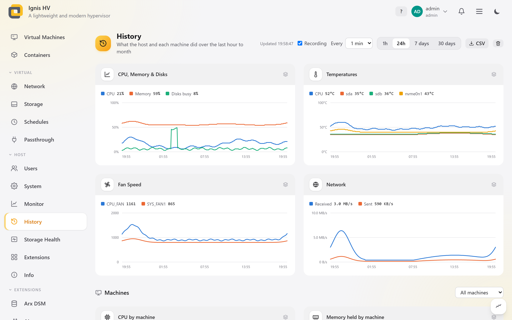
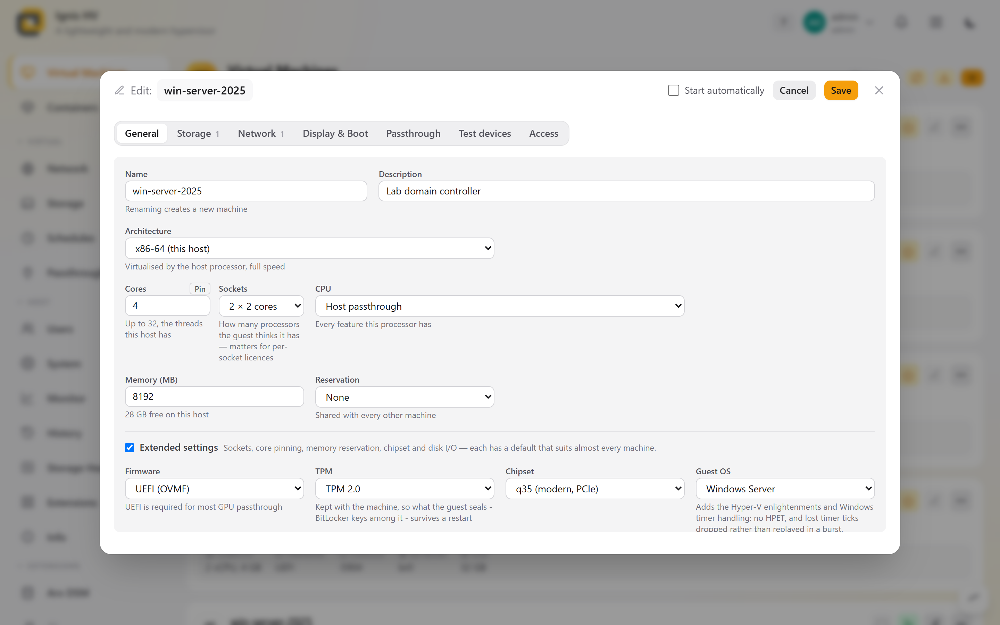
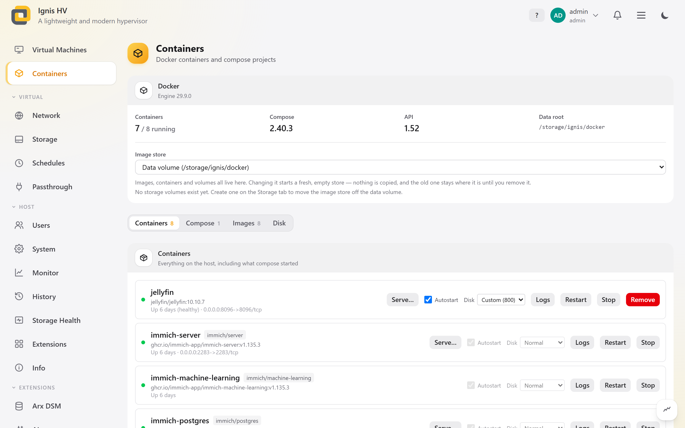
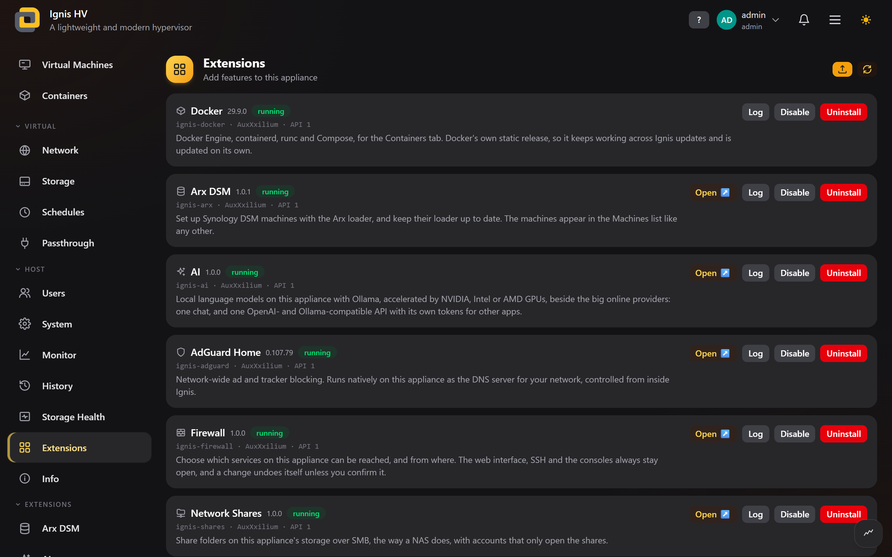

<div align="center">


### Ignis — Hypervisor for your own hardware

Run virtual machines and containers on your own x86-64 PC or server.<br>
Install it once, then manage everything from your browser.

<a href="https://github.com/AuxXxilium/ignis-hv/releases/latest"></a>
<a href="https://discord.auxxxilium.tech"></a>

<br><br>



</div>

---

> [!IMPORTANT]
> * Ignis is a **complete system** for the machine it runs on. It is installed to the machine's own disks and does not run alongside another operating system.
> * Ignis is free and will stay free forever.

> [!WARNING]
> Installing Ignis **erases every disk you select** for it. Back up anything on those disks first. The project is released for educational and learning purposes only, and I'm not liable for damage or loss of any kind.

---

## ✨ What Ignis does

Ignis turns a PC or server into a small, dedicated host for virtual machines and containers. You install it from a USB stick, and from then on everything is done in the browser at `https://<your-ignis-address>`. No desktop, no separate management tool.

* **Virtual machines**: create, edit, clone and run Windows, Windows Server and Linux machines, with BIOS or UEFI and Secure Boot. Each machine can have its own TPM 2.0, so Windows 11 installs without workarounds
* **CPU of your choice**: give a machine the host's own processor, or a named generation from Core 2 to Zen 5 that it can keep when it moves to other hardware. Ignis says what the host cannot provide
* **Screen in the browser**: open any machine's display in a browser tab, change its CD/DVD while it runs, and read its serial output even after it has stopped
* **Snapshots and schedules**: take snapshots and roll back to them, and start, shut down, snapshot or back up machines on a timetable. Old snapshots are cleaned up for you
* **Start at boot**: choose which machines start with the host, and in what order
* **Import and export**: bring in an `.ova` or disks from ESXi, Hyper-V or VirtualBox, which are converted for you. Export a machine as an `.ova` that other hypervisors accept, in the background with a progress bar, or on a schedule as a backup
* **Containers**: run Docker containers and compose projects next to your machines. You can update them by hand or on a schedule, and give each one a disk priority. Docker is an optional extension, installed from the Extensions tab like any other and updated on its own
* **Passthrough**: give a machine a real graphics card, network card, disk controller, USB device or whole disk. Ignis shows which devices can be handed over safely
* **NVIDIA for containers**: an optional extension adds the NVIDIA driver, so containers can use the GPU
* **3D graphics for Linux machines**: an optional extension adds a VirtIO GPU (3D), which draws a Linux guest's OpenGL and Vulkan on the host's Intel, AMD or NVIDIA GPU, with no card passed through
* **Firewall**: an optional extension decides which services on the appliance can be reached, and from where. The web interface, SSH and the consoles always stay open, and a change undoes itself unless you confirm it
* **AdGuard Home**: an optional extension runs AdGuard Home natively on the appliance as the DNS server for your network, and you control it from inside Ignis
* **Network shares**: an optional extension shares folders on your storage over SMB, the way a NAS does, with share-only accounts
* **DSM machines**: an optional extension sets up Synology DSM machines on the Arx loader, ready for DSM's installer on the first start, and keeps their loader up to date
* **AI**: an optional extension runs language models on the appliance with Ollama, on its NVIDIA, Intel or AMD GPU (CUDA, Vulkan or ROCm), beside online providers such as OpenAI, Anthropic and Gemini with your own keys. One chat for all of them, and one OpenAI- and Ollama-compatible API with its own tokens, so other apps use every model without holding a provider's key
* **Storage**: install to one disk or several with software RAID, and add more disks later as extra volumes (ext4, XFS or btrfs, alone or as RAID)
* **Storage health**: see the errors your disks, arrays and filesystems have recorded, run self-tests and read-only surface scans, check all data for silent damage once a month, and let idle disks spin down
* **History**: what the host and each machine did, recorded in the background — CPU, memory, temperatures, fans, disks and network for the host, and CPU, memory, disk and network for every machine — kept at full detail for two days and as 15-minute averages for a month, with CSV export. Recording never keeps a disk from spinning down
* **Networking**: private networks with NAT, or bridges that put machines directly on your network. VLANs and bonded network cards are supported
* **Users and roles**: admin, operator and viewer accounts, each limited to the machines and pages you choose
* **Host controls**: live monitoring, CPU speed and power settings, fan curves, time, services, and HTTPS with your own certificate or a free one from Let's Encrypt
* **Extensions**: add services, commands or pages to the appliance, and they survive updates. Install and update them from the Ignis releases on the Extensions tab, or upload your own
* **Safe updates**: install the newest release straight from the System tab, or a version from a file or a link. The previous version is kept, so you can go back to it from the boot menu

---

## 🧭 How it works

```
USB stick → Installer → choose disks and RAID → Ignis on the machine's own disks
                                                   └─ web interface at https://<address>
                                                        ├─ virtual machines (KVM/QEMU)
                                                        ├─ containers (Docker)
                                                        └─ host: storage, network, users, updates
```

Ignis keeps two things apart: **the system**, which is small and replaced as a whole by each update, and **your data**: machines, disk images, ISOs, containers and settings. Your data lives on its own volume, so an update never touches it and a failed update can be undone.

---

## 🖥️ The web interface

| Page | What you do there |
| :-- | :-- |
| **Virtual Machines** | Create, start, stop and edit machines, open their display, change discs, take snapshots, clone, import and export as `.ova` |
| **Containers** | Run containers and compose projects, pull images, update and clean up |
| **Network** | Private and bridged networks for machines, plus the host's own address, VLANs and bonds |
| **Storage** | Disk images, ISOs, uploads and extra storage volumes |
| **Schedules** | Timed start, shutdown, snapshot, `.ova` backup, container update and data check tasks |
| **Passthrough** | Graphics cards, PCI devices and USB devices that machines can use |
| **Users** | Accounts, roles, and which machines and pages each user sees |
| **System** | Network, time, services, HTTPS and updates |
| **Monitor** | Live CPU, memory, network and temperature readings, plus CPU and fan control |
| **History** | What the host and each machine did over the last hour, day, week or month, with CSV export |
| **Storage Health** | Disk, RAID and filesystem errors, self-tests, surface scans, the monthly data check and disk spin-down |
| **Extensions** | Install, update, enable and remove extensions, from the Ignis releases or your own upload |
| **Info** | What this host supports, and a report to copy into a bug report |

Every page has a **?** button with help written for that page, including what common error messages mean.

On **Monitor**, **History** and **Storage Health** you arrange the cards yourself: drag them where you want them and make them as wide as you like.

The interface has a light and a dark mode and several accent colours to choose from.

### 📸 A look inside

<table>
  <tr>
    <td width="50%"><br><sub><b>Monitor</b>: the host right now, down to every core and its clock</sub></td>
    <td width="50%"><br><sub><b>History</b>: the last hour, day, week or month, host and machines</sub></td>
  </tr>
  <tr>
    <td width="50%"><br><sub><b>Machine editor</b>: CPU, memory, firmware, TPM and the guest's OS on one tab</sub></td>
    <td width="50%"><br><sub><b>Containers</b>: Docker containers and compose projects beside the machines</sub></td>
  </tr>
  <tr>
    <td width="50%"><br><sub><b>Extensions</b>: add only what you use, each updated on its own</sub></td>
    <td width="50%"><br><sub><b>Virtual Machines</b>: guest agent, addresses and passthrough at a glance</sub></td>
  </tr>
</table>

<sub>Screenshots of the real interface with sample data.</sub>

---

## 📋 What you need

* An x86-64 machine you own, with virtualisation (Intel VT-x or AMD-V) turned on in the bios
* For passthrough: an IOMMU (Intel VT-d or AMD-Vi), also turned on in the bios
* A USB stick for the installer
* One or more disks for Ignis. 64 GB or more is a good start, and your machines need room on top of that
* Two or more disks if you want RAID
* A wired network

The **Info** page shows what your host supports once Ignis is running, and says what is missing if something is.

---

## 💿 Installing

1. Download the latest ISO from the [releases](https://github.com/AuxXxilium/ignis-hv/releases/latest) and write it to a USB stick
2. Boot the machine from the stick and choose **Install**
3. Pick the disks to install to. **Everything on them is erased**
4. Choose how the disks work together, for the system and for your data separately: a single disk, a mirror, or another RAID level. Only the levels your disk count allows are offered
5. Set a root password
6. Remove the stick and reboot. The screen shows the address to open in your browser. Sign in as `root`

With several disks, Ignis puts a boot loader on every one of them, so the machine still boots if one disk fails.

---

## ⬆️ Updates

Updates are done under **System → Update**. It shows the newest release that carries an update, and **Download and stage** fetches it on the appliance and checks it against the SHA-256 GitHub records for the file. You can also give it an update file, or a link to one from the [releases](https://github.com/AuxXxilium/ignis-hv/releases/latest). Ignis prepares the new version next to the running one, and your machines keep running while it does. When you click **Apply**, it restarts into the new version.

Extensions are updated on their own, from the **Extensions** tab: it lists what the releases offer for your system and installs or updates it there.

Your settings, passwords and certificates are carried across. Machines, disk images, containers, networks and users are never touched by an update.

The previous version is kept for one update cycle. If something is wrong, choose it from the boot menu to go back.

---

## 🔒 Security

* Every action in the interface checks who is signed in and what they are allowed to do. Hiding a page in the interface is not what protects it
* Failed sign-ins are rate-limited, and repeated guessing at the login page or SSH gets the address blocked for a while
* A machine's display is only reachable through the signed-in web interface, never directly over the network
* HTTPS is available with a self-signed certificate, one you upload, or a free one from Let's Encrypt
* Extensions and containers run with a lot of access to the host, so install only what you trust. Only admins can manage them

---

## 🧰 More from the Arc Project

| Project | Description |
| :-- | :-- |
| [Arc Loader](https://github.com/AuxXxilium/arc) | Redpill loader for DSM 7.x |
| [arx](https://github.com/AuxXxilium/arx) | The evolution of Arc: set up entirely from your browser |
| [Arc Control](https://github.com/AuxXxilium/arc-control) | DSM app for loader settings, monitoring and hardware tuning |
| [AuxXxilium](https://github.com/AuxXxilium) | Everything else from the Arc Project |

---

### Developer

- <a href="https://github.com/AuxXxilium">AuxXxilium</a>
- <a href="https://github.com/FulcrumCode">Fulcrum</a>

### License

GPL-3.0. The included third-party drivers keep their own licenses.

<div align="center">

[](https://github.com/AuxXxilium/ignis-hv)
[](https://discord.auxxxilium.tech)

</div>
